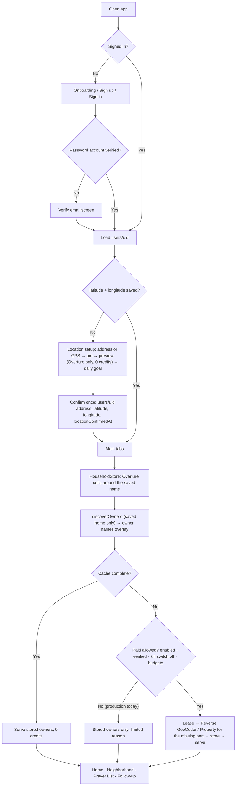

# GPS PARA EL CIELO: app flow

> **Current flow (2026-11-24) is the section directly below.** Everything
> after it is the 2026-11-22 audit, kept as history; where they disagree,
> the 2026-11-24 section wins. Part of the
> [master blueprint](GPS_PARA_EL_CIELO_MASTER_BLUEPRINT.md); diagrams:
> [02](diagrams/02_signup_authentication.md),
> [03](diagrams/03_primary_location_onboarding.md),
> [09](diagrams/09_prayer_list_lifecycle.md).

## Current flow — fixed primary location (2026-11-24)

Implemented and tested **locally**; the backend half is **not deployed**
(production still runs the 2026-11-23 functions and rules).

| Step | Behaviour | Code / proof | Status |
|---|---|---|---|
| Route after sign-in | verify email (password) → has latitude+longitude → main tabs, else Location setup | `auth_controller.dart` `routeAfterSignIn` | IMPLEMENTED AND TESTED |
| Location setup | address search (US) or GPS → confirm pin → nearby preview with `preview: true` (never Melissa, never on drag or typing) → daily goal → confirm | `location_setup_controller.dart` `_loadPreview`, `confirmLocation`; `test/location_setup_test.dart` | IMPLEMENTED AND TESTED |
| Fixed-location notice | "Choose carefully: this becomes your neighborhood. To change it later, contact support." | `location_setup_screen.dart` `_FixedLocationNote` | IMPLEMENTED |
| Save once | `AuthService.updateLocation` writes the location + `locationConfirmedAt` (server time) + `locationVersion: 1`; retries without the stamps if old rules refuse them; double submit blocked | `auth_service.dart`; rules test "set once at setup, then locked" | IMPLEMENTED AND TESTED |
| Locked | rules refuse any later client change of address/latitude/longitude/stamps; other profile fields still save | `firestore.rules` `locationChangeAllowed`; `tool/firestore_rules_test` (4 tests) | IMPLEMENTED AND TESTED, **not deployed** |
| No location editor | Home, Neighborhood, Prayer List show "Contact support" instead of "Change home address"; Profile shows "Your neighborhood" read-only; "Set as my home" removed | `primary_location_help.dart`; `test/fixed_location_test.dart`, `test/home_screen_test.dart` | IMPLEMENTED AND TESTED |
| Look around another place | **REMOVED 2026-11-24** (client approved signup-only location); every screen shows the saved home | — | REMOVED |
| Server-side location | `discoverOwners` searches only around `primary_locations/{uid}` (pinned from users/{uid} on first use); client point > 250 m away → `location_not_authorized` | `functions/src/owners.js` `primaryLocation`; `functions/test/blueprint.test.js` | IMPLEMENTED AND TESTED, **not deployed** |
| Correction | support → `functions/tool/location_admin.js correct` (operator, reason, ≤ 2/365 days, audit in `location_corrections`) | `functions/src/location.js`; `functions/test/ops_tools.test.js` | IMPLEMENTED AND TESTED |
| Existing users | a saved latitude/longitude is their primary location (locked automatically); missing/invalid → Location setup; no data deleted | rules test "existing users … locked with no migration"; `location_admin.js status` | IMPLEMENTED AND TESTED |
| Paid discovery | needs `MELISSA_OWNER_DISCOVERY_ENABLED`, verified account, kill switch off, budgets; production: OFF and budget 0 | `owners.js`; `zero_budget.test.js` | IMPLEMENTED AND TESTED; **OFF in production** |
| Prayer, rounds, follow-ups | unchanged; never trigger Melissa | `household_store.dart`, `user_repository.dart` `startPrayerRound` | IMPLEMENTED AND TESTED |

Sections B, E and F below describe the **old** model (location changeable
from Profile / Neighborhood / setup preview costs). They are kept only as
history: the location can no longer be changed in the app, the setup preview
never calls Melissa, and nearby/overlapping areas reuse the shared property
cache (`owner_properties/mel:{MAK}`).

---

# 2026-11-22 app flow audit (history)

Audited 2026-11-22 from the code in this repository (branch
`chore/firebase-client-migration`, uncommitted work included). Everything
below is what the code does **today**, with the file/function or test that
shows it. Nothing was deployed, no Firestore rules or production data were
changed, no paid Melissa call was made for this audit.

Status labels:

- **IMPLEMENTED AND TESTED**: code + an automated test that covers it
- **IMPLEMENTED BUT NOT TESTED**: code exists, no test covers it
- **PARTIALLY IMPLEMENTED**
- **NOT IMPLEMENTED**
- **BLOCKED**: by permissions (client Google Cloud APIs/IAM) or licensing
  (Melissa owner-name terms)

Tests run for this audit (all pass): Flutter 415 (including the 18 auth /
location / profile / store files = 196 tests and the 8 prayer / follow-up
files = 107 tests); Cloud Functions 58 (`functions/test`, Firestore
emulator). Firestore rules tests (`tool/firestore_rules_test/rules.test.js`,
16 tests) were not re-run (port in use); last recorded pass 2026-11-21.

---

## Update 2026-11-22 (afternoon): cache-first Melissa, prayer history

Implemented and tested locally today (details: `docs/ARCHITECTURE.md`,
`docs/MELISSA_CACHE_STRATEGY.md`, `docs/COST_MODEL.md`). Where this file's
older sections disagree, this list wins:

| Item | Now | Status |
|---|---|---|
| Pilot (50 paid homes) | recovered: exported from the running emulator (it was only in memory), checksummed backup, verified restore, rebuilt from recordings into the new cache (53 replays, 0 network, 0 credits) | IMPLEMENTED AND TESTED (`functions/test/pilot.test.js`) |
| Emulator data | `tool/emulators.sh`: import + export-on-exit + export every 10 min to `.emulator-data/` (git-ignored); survived a restart | IMPLEMENTED AND TESTED (manual) |
| Spending guard | emulator replay-only regardless of `MELISSA_REPLAY_ONLY`; global fetch wrapped (`discoverNearby` gap closed); tests block all non-local hosts | IMPLEMENTED AND TESTED |
| Cache | canonical `owner_properties/mel:{MAK}` + `owner_scans` + coverage-aware nearest 50 (shared only if licensed; per user by default) | IMPLEMENTED AND TESTED; shared mode BLOCKED (licence) |
| Overlapping / nearby spots | stored names reused (0 credits at 50 / 200 / 400 m from the pilot), marked `partial` when not provably nearest | IMPLEMENTED AND TESTED |
| Concurrency | one paid job per area (lease, double-checked), 100-user test → 1 paid discovery | IMPLEMENTED AND TESTED |
| Budgets | per request 920, per user 5/day, 2,000/day, 20,000/month; resumable; negative cache 90 days | IMPLEMENTED AND TESTED |
| Setup preview / pin drag | Overture only, never Melissa (bug 1 fixed) | IMPLEMENTED AND TESTED |
| Discovery switch off | cache-only answer + what is missing (was: refused) | IMPLEMENTED AND TESTED |
| Prayer history | `prayer_log/{roundId}_{householdId}` append-only; rounds recorded in `prayer_rounds` | IMPLEMENTED AND TESTED (`test/prayer_history_test.dart`); lifetime count from the log is not yet shown in the UI (PARTIAL) |
| Round membership | recorded per round; the day plan still uses the current neighborhood (stable, from the cache) | PARTIALLY IMPLEMENTED |
| Card title | user's name → recorded owner → **street address** → "Neighbor" only without an address | IMPLEMENTED AND TESTED |
| Second owner | shown in household details | IMPLEMENTED AND TESTED |
| Account deletion | app deletes prayer history and rounds; `cleanupDeletedUser` (auth trigger) deletes everything under `users/{uid}`, usage counters, locks | IMPLEMENTED AND TESTED (function not deployed) |
| Rules | `prayer_log`, `prayer_rounds`, server-only Melissa collections; 19 rules tests | IMPLEMENTED AND TESTED, deploy BLOCKED |
| Offline | Firestore offline cache keeps statuses / history; owner names come from the function and are not shown offline (Overture fallback) | PARTIALLY IMPLEMENTED |

Tests after this update: functions 76, Flutter 428, rules 19 — all pass.

---

## A. The two discovery modes (read this first)

The app has two ways to find "the 50 homes". Which one runs is a **build
switch**, not something the user chooses:

| | Overture-first (DEFAULT today) | Melissa-first (built, OFF) |
|---|---|---|
| Switch | `MELISSA_OWNERS` not set (`lib/core/config/feature_flags.dart` `melissaOwners`, default false) | app `--dart-define=MELISSA_OWNERS=true` + server `MELISSA_OWNER_DISCOVERY_ENABLED=true` + `MELISSA_ALLOW_OWNER_NAMES=true` |
| Source | Overture address cells in Firestore `cells/{geohash}` (`lib/core/data/cell_source.dart` `CellArea`) | Cloud Function `discoverOwners` (`functions/src/owners.js`): Melissa Reverse GeoCoder + Property |
| Names on cards | none ("Neighbor"), unless the user typed a name or ran "Check address" with owner names on | the recorded owner on every card |
| Cost | 0 Melissa credits (Firestore reads) | ≈ 668–920 credits per new (user, area) |
| Status | IMPLEMENTED AND TESTED; production cells imported only for the San Diego area (other waves await approval) | IMPLEMENTED AND TESTED locally (13 backend + 6 app tests, real pilot on the emulator); **BLOCKED** for production (Melissa licence confirmation + client APIs/IAM + deploy approval) |

`HouseholdRepository.nearestArea` (`lib/core/data/household_repository.dart`)
picks the source: Melissa-first `OwnerArea` when the switch is on, with
Overture as its fallback; otherwise Overture (optionally topped up by the
Melissa gap-filler `GapFilledArea`, also OFF).

**So the app a user installs today is Overture-first and shows "Neighbor".**

---

## B. New user journey

| Step | What the code does | Proof | Status |
|---|---|---|---|
| Splash | Waits 2.6 s. Not signed in → Onboarding. Signed in → loads profile → `routeAfterSignIn` | `splash_controller.dart` `_startTimerAndNavigate` | IMPLEMENTED AND TESTED |
| Onboarding | "Get started"/"Skip" → Sign in. No "seen" flag: shown on every signed-out launch | `onboarding_controller.dart` | IMPLEMENTED BUT NOT TESTED |
| Sign up | Email + password. Google/Apple create the profile on first sign-in (`ensureProfile`). Phone OTP signs in **existing** accounts only (a new phone user is rejected) | `sign_up_controller.dart`, `auth_service.dart` `register`, `_signInRegisteredPhone`; `auth_service_test.dart` | IMPLEMENTED AND TESTED |
| Email verification | Required for password accounts; screen auto-checks (3 s, then 10 s, up to 10 min) and on resume | `auth_service.dart` `needsEmailVerification`, `verify_email_controller.dart`; `verify_email_flow_test.dart` | IMPLEMENTED AND TESTED |
| Route after sign-in | verify email → else has latitude+longitude → main tabs, else Location setup | `auth_controller.dart` `routeAfterSignIn` | IMPLEMENTED AND TESTED |
| Location setup (4 steps) | 1 address search or "Use my current location" · 2 confirm pin (drag map) · 3 daily goal + optional prayer intention · 4 preview of the nearest homes | `location_setup_screen.dart`, `location_setup_controller.dart`; `location_setup_test.dart` | IMPLEMENTED AND TESTED |
| Automatic vs manual | Both. GPS asks permission only when not yet decided; denied/timeout show a fix that opens Settings | `location_service.dart` `currentLocation`; `location_setup_test.dart` | IMPLEMENTED AND TESTED |
| Any US location? | Address search is US-only (Photon US box + country filter). **GPS fix, pin drag and rules do not enforce US** | `address_suggestion_service.dart` `usOnly`; `address_suggestion_service_test.dart` | PARTIALLY IMPLEMENTED |
| Saved | `users/{uid}`: address, latitude, longitude, searchRadiusKm, dailyPrayerTarget, prayerIntention (if set) | `auth_service.dart` `updateLocation`; `location_setup_test.dart` "saves home, range and daily goal together" | IMPLEMENTED AND TESTED |
| First 50 homes | Overture-first: nearest 50 cell records around the saved point (3×3 then 5×5 geohash-5 cells). Melissa-first: `discoverOwners` (section J) | `cell_source.dart` `CellArea.ensure`; `owners.js` `discoverOwners` | IMPLEMENTED AND TESTED |
| Only owner-named homes? | Only in Melissa-first mode (`OwnerDiscoveryService.recordFrom` rejects records without a name) | `test/owner_discovery_test.dart` "records without an owner name are never shown" | IMPLEMENTED AND TESTED (OFF) |
| Fewer than 50 valid Melissa homes | The real number is shown (e.g. "23 households"); no placeholders | `owners.js` (returns named only); `owner_discovery_test.dart` "only named homes, as many as really found"; `functions/test/owners.test.js` | IMPLEMENTED AND TESTED |
| Daily goal | Picked in setup step 3 and in Profile › Prayer preferences: **3, 5, 10 or 15**; clamped to the neighborhood size. **Default 5** | `search_range.dart` `goalOptions`, `clampGoal`; `user_model.dart` (dailyPrayerTarget 5); `prayer_preferences_sheet_test.dart` | IMPLEMENTED AND TESTED |

**Cost bug (Melissa-first only):** the setup preview (step 4) calls
`nearestArea` for every location the user selects or drags to
(`location_setup_controller.dart` `_schedulePreview`/`_loadPreview`, 350 ms
debounce). With `MELISSA_OWNERS=true` each new ~110 m spot is a new paid
`discoverOwners` run. Must be fixed before Melissa-first is enabled.

---

## C. Daily prayer goal, rounds and reset

How the code works (`lib/features/prayer_list/domain/services/prayer_list_service.dart`
`buildPlan`, `lib/core/models/household_model.dart`):

- **"My neighborhood" / the round** = the nearest `radiusHomes` homes around
  the saved home (default 50; options 5/10/15/20/25/50). The round size is
  however many homes were actually loaded (`cycleTotal`).
- **Each household has two "prayed" meanings**
  - *prayed this round*: `isPrayed && prayedAt >= users/{uid}.prayerCycleStartedAt` (`HouseholdModel.prayedInCycle`)
  - *prayed today*: `prayedAt` falls on the phone's local calendar day (`HouseholdModel.prayedOn`)
- **Today's list** = homes prayed today + the nearest homes not yet prayed
  this round, up to the daily goal. Homes prayed on an earlier day of the
  same round are skipped.
- After reaching the goal: "Next neighbors / Extra prayers today" offers
  the next un-prayed homes; extras count separately ("+N extra").

| Question | Answer | Proof | Status |
|---|---|---|---|
| Pray for all 50 every day? | No. Only the daily goal (3/5/10/15) | `buildPlan`; `widget_test.dart` | IMPLEMENTED AND TESTED |
| Any number (e.g. 20)? | No: only 3, 5, 10, 15 in the UI (rules allow 1–100) | `search_range.dart` `goalOptions`, `firestore.rules` | PARTIALLY IMPLEMENTED |
| How the 5 are picked | Nearest first among homes not yet prayed this round | `buildPlan`; `household_store_test.dart` "nearest first, the next ones each day, then a new round" | IMPLEMENTED AND TESTED |
| After praying the 5 | They stay on today's list as prayed; "Next neighbors" offered for extras | `GoalReachedCard`; `prayer_progress_card_test.dart` | IMPLEMENTED AND TESTED |
| Reset next day | Nothing is written at midnight; "today" is recomputed from `prayedAt` on the phone's local date. Prayer List re-plans 1 s after local midnight; **Home has no midnight timer** | `prayer_list_controller.dart` `_scheduleMidnight`; `home_controller.dart` | PARTIALLY IMPLEMENTED |
| Counter vs records | Only the computed daily count changes; household records stay | `prayedOn`, `prayedInCycle` | IMPLEMENTED AND TESTED |
| Same home tomorrow? | Not in the same round (it's "prayed this round"); yes after a new round | `buildPlan` | IMPLEMENTED AND TESTED |
| Yesterday vs today | `prayedAt` date vs today (local) | `prayedOn` | IMPLEMENTED AND TESTED |
| Daily vs lifetime totals | Daily: computed, not stored. Lifetime: server `count()` of `isPrayed == true` etc. **No prayer history log** | `household_repository.dart` `countStatuses` | PARTIALLY IMPLEMENTED |
| `prayerCycleTarget` (default 20) | Stored but **never used** by any logic | no use in `lib/` outside `user_model.dart` | NOT IMPLEMENTED (dead field) |
| Timezone | Phone clock and local date; `prayedAt` is the phone time; rules don't check it | `household_repository.dart` (`Timestamp.now()`), `prayedOn` | IMPLEMENTED (clock-dependent) |

---

## D. After all 50 are prayed

Step by step, today's code (`buildPlan`, `home_screen.dart`,
`prayer_list_screen.dart`, `prayer_list_controller.dart`):

1. Home shows **"Round complete!"** instead of rows; Prayer List shows
   `RoundCompleteCard` (prayed / visited / invited stats + "Start new round").
   Tests: `home_screen_test.dart` "a finished round says so instead of rows";
   `prayer_progress_card_test.dart`. IMPLEMENTED AND TESTED
2. The Neighborhood list does **not** empty: it still shows the same 50 (marked prayed).
3. **The next day** (round complete and nothing prayed today) the Prayer List
   automatically starts a new round: writes `users/{uid}.prayerCycleStartedAt = now`
   (`_maybeStartNewRound`, `startNewCycle`). Or the user taps "Start new round".
4. In the new round **the same 50 homes come back**, nearest first. Old
   `isPrayed`/`prayedAt` are not erased; they stop counting (prayedAt < round start).
   Test: `widget_test.dart` "a prayer before the cycle started no longer counts".
5. **No new batch, no larger radius, no "next 50"**: NOT IMPLEMENTED. The
   only way to get different homes is to raise "Homes in my neighborhood"
   (max 50) or change location.
6. Melissa credits: **none** for a new round (same homes, no lookup).
7. Weeks/months/years: the app cycles the same nearest ≤ 50 homes round
   after round. Each new round overwrites `prayedAt` (no history).

---

## E. Location change (User A: Chula Vista → New Jersey → back)

| Question | Answer (code) | Proof |
|---|---|---|
| 20 completed prayers | Kept. Statuses are `users/{uid}/household_status/{householdId}`, keyed by household id, not location; nothing is deleted on a home change | `firestore_paths.dart`; `HomeAddressService.save` |
| Permanently saved? | Yes, until the user un-prays (deletes `prayedAt`) or deletes the account | `household_repository.dart` `saveHousehold` |
| Still visible? | Not in Home/Prayer List (built only from homes around the current home). Still in Follow-up and Profile totals | `household_store.dart` `_rebuild`; `countStatuses` |
| New 50 in New Jersey? | Overture-first: NJ cells exist in the local build but **are not imported to the client project yet** (Wave 1 awaits approval) → "area not available" until imported. Melissa-first: a new `discoverOwners` run | `cell_source.dart`; `docs/NATIONWIDE_CELLS.md` |
| New Reverse GeoCoder / Property calls? | Melissa-first: yes, unless this user already has a cache for that exact ~110 m grid key | `owners.js` (cache check before reservation) |
| Credits | Overture-first: 0. Melissa-first: 200 (100 addresses) + 9 × lookups (until 50 named, max 80) = **≈ 668–920** per new area | `owners.js`; pilot: 668 |
| Cache checked first? | Yes: `users/{uid}/owner_areas/{lat3_lon3}` (or shared `owner_areas/{key}` if enabled) before any Melissa call | `owners.js`; test "a cached area is free" |
| Back to Chula Vista | Same saved coordinates → same key → cached result (0 credits) **within 30 days**; same `mel:<MAK>` ids → earlier statuses reappear | `discover.js` `areaKey`; ids in `owners.js` |
| After 30 days | Cache expired → full new paid run | `MELISSA_CACHE_DAYS=30` |
| Slight GPS change | Key = latitude/longitude rounded to 3 decimals (~110 m × ~93 m at 32° N). A move into a neighbouring grid square = **new full paid run**, even though most homes overlap | `discover.js` `areaKey` |
| Nearby/overlapping areas | **Not deduplicated.** No property-level reuse in `discoverOwners`; overlapping areas pay again for the same properties | `owners.js` |

Local emulator vs production: the caching code is identical (both use
Firestore). The emulator additionally records every real Melissa response
in `functions/.melissa-recordings/` and can replay it for free
(`functions/src/recorder.js`, emulator-only, `MELISSA_REPLAY_ONLY`). A
deployed function never replays.

---

## F. App restart, logout, reinstall (Melissa credits)

In Overture-first mode none of these call Melissa (0 credits). In
Melissa-first mode the app calls `discoverOwners` whenever a new
`OwnerArea` is created (`HouseholdStore.refreshHouseholds` /
`_refreshHomeIfNeeded`), and the server answers from the per-user cache:

| Action | Paid Melissa call? | Why |
|---|---|---|
| Close and reopen | No (function runs, cache hit) | `bindUser` → `refreshHouseholds` → server cache `users/{uid}/owner_areas` |
| Force close | No | in-memory state is lost; server cache remains |
| Phone restart | No | same |
| Log out / log in | No | cache is per uid on the server; `HouseholdStore.clear` clears memory only |
| Reinstall | No | cache is in Firestore |
| Pull to refresh (Home) | No | `RefreshIndicator` → `refreshHouseholds` → cache hit |
| Switch Home ↔ Neighborhood | No call at all | tabs share `HouseholdStore`; nothing reloads on a tab switch |
| Open a household | No | the sheet doesn't call Melissa; "Check address" uses `users/{uid}/enrichment/{id}` (30 days) |
| Same location tomorrow | No | within 30 days the cache hit returns before any credit reservation |
| Same location after 30 days | **Yes, full paid run** (≈ 668–920) | cache `expiresAt` passed |
| New "Look around" place | *(feature removed 2026-11-24)* | — |
| Each spot in setup preview | **Yes** (bug, see B) | `_loadPreview` |

Tests: `functions/test/owners.test.js` "a cached area is free"; the
app-side calls (restart, logout, reinstall) are IMPLEMENTED BUT NOT TESTED
end-to-end; verified manually on the Android emulator (pilot area reload =
cache hit, 0 credits).

---

## G. Multi-user isolation (User A and User B in Rancho del Rey)

| Question | Answer | Proof | Status |
|---|---|---|---|
| Same 50 for B? | Yes in practice (same Melissa data, same algorithm), from B's own lookup | `owners.js` | IMPLEMENTED AND TESTED |
| B charged again? | **Yes, ≈ 668 again**, because the cache is per user by default | `owners.js` (`sharedCache: false`); test "not shared by default" | IMPLEMENTED AND TESTED |
| Shared cache | Implemented: `MELISSA_OWNER_SHARED_CACHE=true` stores `owner_areas/{key}` for everyone. OFF until Melissa allows sharing | test "the shared cache serves other users" | IMPLEMENTED AND TESTED, BLOCKED (licence) |
| B sees A's prayers? | No. Statuses are under `users/{uid}/household_status`; rules allow only the owner | `firestore.rules`; `rules.test.js` | IMPLEMENTED AND TESTED (rules not yet deployed) |
| A finishing 50 affects B? | No (round start and statuses are per user) | `users/{uid}.prayerCycleStartedAt` | IMPLEMENTED AND TESTED |
| B prays independently? | Yes | same | IMPLEMENTED AND TESTED |
| Daily goal per user? | Yes, `users/{uid}.dailyPrayerTarget`, computed per phone | `user_model.dart` | IMPLEMENTED AND TESTED |
| Names A typed | Private to A (`household_status.residentName`) | `resident_name_test.dart` "another user doesn't see my names" | IMPLEMENTED AND TESTED |
| Rules protect private data? | Yes in the rules file (owner-only `users/{uid}` and subcollections; enrichment/gap_areas server-written, owner-read; owner_areas/melissa_usage default-deny = server only). **Deployment to the client project awaits approval** | `firestore.rules`; `rules.test.js` (16) | IMPLEMENTED AND TESTED, deploy BLOCKED |

---

## H. Melissa credit consumption (exact rules in the code)

| Item | Code behaviour | Proof |
|---|---|---|
| Reverse GeoCoder | 2 credits per address returned; asks for 100 within 1 mile (`MELISSA_OWNER_RADIUS_MILES`), apartments off; Melissa max 100 records / 10 miles | `owners.js`, `discover.js` `buildReverseUrl` |
| Property LookupProperty | 9 credits per lookup, by Melissa Address Key, nearest first, 4 at a time, until 50 named or 80 lookups | `owners.js`; test "stops looking up once the target is reached" |
| Not found / wrong address / commercial / no owner | Still charged (9), counted as spent, excluded from results | `owners.js` |
| Network/timeout/licence errors | Not counted (Melissa didn't process) | `UNCHARGED` in `owners.js`; tests |
| Repeat request | Cache hit → 0 | test "a cached area is free" |
| Area cache | Per user `users/{uid}/owner_areas/{lat3_lon3}`; 30 days; not written when Melissa ran out of credits | `owners.js` |
| Property-level cache | **NOT IMPLEMENTED** for discovery (only per-user per-household `enrichment` for "Check address") | `owners.js`, `enrich.js` |
| Shared vs per user | Per user by default; shared by switch | see G |
| Expiry | `MELISSA_CACHE_DAYS` (30) | `index.js` |
| Concurrent requests, same area | **No lock**: two simultaneous requests both pay (each within the limits) | `owners.js` (no in-flight marker) |
| Daily limits | 5 new areas per user per UTC day; 2,000 discovery credits per UTC day app-wide; reserved up front, unused given back | `reserveOwners`/`settleOwners`; limit tests |
| Credit exhaustion (Melissa GE14) | Stops, keeps what it found, writes `melissa_usage/state.outOfCreditsAt`, pauses Melissa calls 6 h; app falls back to Overture with "paused" text | test "out of credits" |
| Retries | Property: 1 retry on 429/5xx/network/timeout (backoff). Reverse GeoCoder: none. App: none (falls back) | `melissa.js` `request`, `discover.js` `reverseLookup` |
| Monthly estimate | Per-user cache: ≈ 668–920 × (users × new areas per 30 days). E.g. 100 users × 1 area = 66,800–92,000 credits/month. Shared cache: ≈ 668–920 × distinct areas per 30 days | arithmetic; dollar price per credit not on record |

**Does the code prevent duplicate paid lookups across nearby locations and
different users today?** No. It prevents repeats only for the *same user*
at the *same ~110 m key* within 30 days. Different users (shared cache OFF),
neighbouring keys, concurrent requests and the setup preview all pay again.

---

## I. Local emulator vs production

| | Local emulator (developer Mac) | Production (`gps-para-el-cielo`) |
|---|---|---|
| Functions | running (`firebase.lan.json`): `discoverOwners`, `enrichHousehold`, `discoverNearby` | **not deployed** (client must enable APIs/IAM; deploy approval) |
| Owner names | `MELISSA_ALLOW_OWNER_NAMES=true` in `functions/.env.local` | `false` in `functions/.env.gps-para-el-cielo` |
| Melissa-first | `MELISSA_OWNER_DISCOVERY_ENABLED=true`, `MELISSA_REPLAY_ONLY=true` | `false` |
| Cache | Firestore emulator (same code) + recordings (free replay) | Firestore (same code), no replay |
| Data | pilot: 50 named homes (Rancho del Rey) for the emulator test user | none |
| Rules | emulator loads `firestore.rules` | **not deployed yet** |

---

## J. Melissa-first vs Overture fallback

| Question | Answer | Status |
|---|---|---|
| Melissa-first fully implemented? | Server + app + UI yes; production gated | IMPLEMENTED AND TESTED / BLOCKED |
| Overture in the normal flow? | Default mode: yes (it *is* the flow). Melissa-first mode: only as fallback | — |
| Fallback conditions | any error from `discoverOwners`: switched off, owner names off, not signed in, daily limits, out of credits/paused, Melissa errors, timeout (150 s), no network (`OwnerArea._load` catch-all) | IMPLEMENTED AND TESTED ("Melissa unavailable: Overture fallback") |
| Zero named homes | Empty list, "0 households", note "property owners from public records"; no fallback (not an error) | IMPLEMENTED BUT NOT TESTED in UI |
| More than 50 over time? | No. `target` max 50 (`validateOwners`); addresses beyond those looked up are discarded, not stored | NOT IMPLEMENTED |
| "Next 50" / pagination / expansion | None | NOT IMPLEMENTED |
| Reuse a saved Melissa property without a call | Only through the same user's area cache document | PARTIALLY IMPLEMENTED |
| Shared Firestore cache | Implemented behind `MELISSA_OWNER_SHARED_CACHE` | IMPLEMENTED AND TESTED, BLOCKED (licence) |
| Without Overture in production | Possible only if Melissa always answers; today the fallback relies on Overture cells | PARTIALLY IMPLEMENTED |

LeadGen Property (Melissa's "owner lists by radius") is **not enabled** on
either key (status 116, checked 2026-11-22), and Melissa's Data Products
terms make such lists one-time marketing use. Details: `docs/MELISSA_FIRST.md`.

---

## K. Prayer tracking persistence

| Topic | Code | Status |
|---|---|---|
| Daily goal storage | `users/{uid}.dailyPrayerTarget` (int) | IMPLEMENTED AND TESTED |
| Daily counter | not stored; computed from `prayedAt` on the phone's local date | IMPLEMENTED AND TESTED |
| Midnight | local midnight on the phone; Prayer List re-plans at midnight, Home does not | PARTIALLY IMPLEMENTED |
| Location persists | only in `users/{uid}` (address, latitude, longitude); no local copy | IMPLEMENTED AND TESTED (`user_location_persistence_test.dart`) |
| Prayer history | only the latest `prayedAt` per household; un-pray deletes it; a new round overwrites it | NOT IMPLEMENTED (no log) |
| Marking prayed idempotent? | Toggle (tap = flip). An unchanged save is skipped (`hasSameStatusAs`); writes are `set(merge)` | IMPLEMENTED AND TESTED |
| Visited / Invited | independent booleans in the same status doc | IMPLEMENTED AND TESTED |
| Follow-up | `hasFollowUp` + `followUpDate` fixed at today + 7 days ("MM/dd/yyyy" string); **no date picker; cannot be turned off from the sheet**; one in-app notification written immediately ("Follow-up Scheduled") | PARTIALLY IMPLEMENTED |
| Follow-up reminder on the due date | none (no server push, no local notifications package) | NOT IMPLEMENTED |
| Completed / skipped / pending states | none | NOT IMPLEMENTED |
| Offline | Firestore default offline cache; optimistic UI; cells read from cache first | IMPLEMENTED BUT NOT TESTED offline |
| Sync failure | status and counts restored + "Could not save" (rules/permission errors; offline writes queue instead of failing) | IMPLEMENTED AND TESTED (`household_store_test.dart` "a failed save restores the previous status") |

Status document: `users/{uid}/household_status/{householdId}` with
`isPrayed, prayedAt, isVisited, isInvited, hasFollowUp, followUpDate, notes,
residentName, address, updatedAt` (allow-list in `firestore.rules`).

---

## L. Scenario table

| User action | Current app behavior | Melissa credits used | Firestore changes | Recommended behavior |
|---|---|---|---|---|
| Sign up, set location | Setup saves home + goal; Overture homes shown | 0 (Overture-first) · Melissa-first: a run per previewed spot (bug) | `users/{uid}` fields | Preview without Melissa; one lookup on Save |
| Open Home first time | Nearest 50, today's 5 | 0 · Melissa-first ≈ 668–920 if no cache | none (cells read) · Melissa-first: `owner_areas` doc, `melissa_usage` counters | Same, with a shared area cache |
| Pray for a home | Marked prayed, counts toward goal | 0 | `household_status/{id}` isPrayed, prayedAt, updatedAt | Also append to a prayer log |
| Pray 5 of 5 | "Goal reached", Next neighbors offered | 0 | as above | same |
| Next day | New 5 nearest un-prayed | 0 | none | same; Home refresh at midnight |
| All 50 prayed | "Round complete!"; next day a new round, same 50 | 0 | `users/{uid}.prayerCycleStartedAt` | Offer "next 50 nearby" (paid, approved) or a new round |
| Change home to NJ | NJ homes (Overture if imported; else unavailable) · Melissa-first new run | 0 · ≈ 668–920 | `users/{uid}` address/lat/lon | Shared + tiled cache |
| Return to Chula Vista within 30 days | Same 50, old statuses | 0 | `users/{uid}` | same |
| Move home 200 m | New area key | 0 · full new run | `users/{uid}` | Reuse overlapping properties |
| Restart / logout / reinstall | Reloads | 0 (cache hit) | none | same |
| Pull to refresh | Reloads | 0 (cache hit) | none | same |
| Same area after 30 days | Reloads | 0 · full new run | `owner_areas` rewritten | Refresh only changed properties / longer licensed cache |
| User B, same area | Own lookup | 0 · ≈ 668 again | B's `owner_areas` | Shared cache (licence) → 0 |
| Tap "Check address" | Melissa Check + Property for one home | 12 first time, 0 for 30 days | `users/{uid}/enrichment/{id}` | Reuse discovery data (0) |
| Delete account | Deletes statuses, notifications, devices, profile | 0 | **leaves** `enrichment`, `gap_areas`, `owner_areas`, usage counters | Delete them too (server-side) |

(Where two values appear: Overture-first · Melissa-first.)

### L2. Melissa-first with the cache-first design (2026-11-22, measured on the pilot data)

| User action | Current app behavior | Melissa credits used | Firestore changes | Recommended behavior |
|---|---|---|---|---|
| Same spot as an earlier search (same user; or any user if shared cache licensed) | 50 named homes, `complete` | 0 | 1 counter | same |
| Spot 50 / 200 / 400 m away | 50 stored names reused, `partial` | 0 | 1 counter | same; pay to prove only if the client wants it (≤ 524–920) |
| Spot 2 km / 5 km away (nothing stored) | local: Overture addresses + "not available yet"; production (when enabled): one paid discovery | 0 locally; ≈ 704 when enabled | scan + ~56 property docs + job + counters | same |
| 100 users open the same new area at once | one job pays, others wait and read it | ≈ 668–704 once | as above, once | same |
| Discovery crashes half-way | next request buys only what is missing | only the missing part | stored answers kept | same |
| Melissa out of credits / over budget | stored homes shown, no call | 0 | none | same |
| Pray for a home | status + history event | 0 | `household_status/{id}`, `prayer_log/{round}_{id}` | same |
| Un-pray | this round's event removed | 0 | both docs | same |
| Start a new round | same 50 homes; round recorded | 0 | `prayer_rounds` ×2, `users/{uid}` | same |
| Owner records older than the licence period | not shown (`expired`), not refreshed | 0 | none | refresh only with approval |

---

## M. Missing functionality and bugs (from this audit)

1. ~~Setup preview spends Melissa credits per spot~~ — FIXED 2026-11-22 (`nearestArea(preview: true)`).
2. ~~No duplicate-lookup protection~~ — FIXED for neighbouring spots and concurrent requests (property cache + lease); across users still needs the licensed shared cache.
3. **No "next 50"** / pagination / expansion; after a round the same homes repeat.
4. ~~No prayer history~~ — FIXED (`prayer_log`); the status still keeps only the latest `prayedAt`.
5. **`prayerCycleTarget` unused** (default 20) while the round size is the number of loaded homes (default 50), which changes if the count changes mid-round.
6. **Prayed tab** counts lifetime prayers (server count) but hides homes prayed in earlier rounds (`HouseholdModel.hasActivity` uses this-round `isPrayed`; `follow_up_controller.dart` `FollowUpTab.prayed`).
7. **Starting a round manually the same day** stops today's earlier prayers from counting today.
8. **Home has no midnight refresh** (`home_controller.dart`).
9. **Follow-up**: fixed +7 days, no date picker, can't turn off from the sheet, no due-date reminder, no completed/skipped states; empty notes become "Follow-up requested." and notes can't be cleared.
10. **No scheduled notifications** (prayer reminders, follow-up due); pushes are sent manually from the Firebase Console.
11. ~~Account deletion leaves server data~~ — FIXED in code (`cleanupDeletedUser`); effective once deployed.
12. **US-only not enforced** for GPS fix / pin drag / rules.
13. **Offline splash path** can skip location setup (`splash_controller.dart` catch).
14. **Logout doesn't clear** the Firestore offline cache on shared devices.
15. Daily goal options limited to 3/5/10/15.
16. "Today" depends on the phone clock/timezone (`prayedAt` = device time).
17. Trust/company owner names are shown as Melissa records them (some look shortened); in the pilot 22 carry Melissa's company flag and 10 its trust flag (flags can overlap); 26 have a second owner (now shown in details).
18. "Neighbor" as the title for homes with an address — FIXED (street address is the title).

---

## N. Recommended production flow vs today

| Desired | Today | Gap |
|---|---|---|
| 1 Select a location | Yes (US search, GPS) | enforce US for GPS |
| 2 Up to 50 nearby residential homes with authorized owner names | Melissa-first built, OFF | Melissa licence + deploy; fix setup-preview cost |
| 3 Own daily goal | 3/5/10/15 | allow a free number (e.g. 1–50) |
| 4 Progress saved independently | Yes (per uid) | deploy rules |
| 5 Daily reset without deleting history | Daily resets by date; history not kept | add `users/{uid}/prayer_log` |
| 6 Continue to next unprayed homes after 50 | No (same 50 repeat) | "Next 50": continue lookups from stored candidates, then a ring farther out |
| 7 Reuse licensed data on revisits | Same user, same key, 30 days | shared, tiled property cache (`properties/{MAK}` + area index), longer licensed TTL |
| 8 Independent progress per user | Yes | — |
| 9 No unnecessary credits | Partial | shared cache, in-flight lock, no Melissa in preview, reuse overlapping properties |
| 10 Reliable across restart/reinstall/devices | Yes (Firestore) | clear offline cache on logout |

## O. Roadmap (proposed order)

1. **Before any production Melissa-first use** (no extra credits):
   setup preview uses Overture or a static map, Melissa only on Save;
   in-flight lock per area (transaction `pending` marker); delete
   `owner_areas`/`enrichment` on account deletion (server function).
2. **Melissa written confirmation** (display, storage period, sharing,
   non-FCRA use) → turn on `MELISSA_ALLOW_OWNER_NAMES`,
   `MELISSA_OWNER_SHARED_CACHE`.
3. **Client cloud setup + deploys** (rules first, then functions) per
   `docs/DEPLOY_FUNCTIONS.md`.
4. **Property-level shared cache** (`properties/{MAK}`) and tiled area keys
   so overlapping/nearby areas reuse lookups.
5. **"Next 50"**: keep the un-looked-up Reverse GeoCoder candidates in the
   area cache; continue Property lookups on demand; then search rings
   farther out (each step shows its credit cost against the admin budget).
6. **Prayer history** (`prayer_log`), fixed round size at round start,
   free daily goal, Home midnight refresh, Prayed-tab fix.
7. **Follow-up**: date picker, complete/skip, server-scheduled reminders
   (Cloud Scheduler + FCM).
8. Overture: keep as fallback until Melissa-first runs in production for
   a full cache period; then decide.

## What could not be verified

- Firestore rules tests were not re-run today (last pass 2026-11-21).
- Production behaviour of the Cloud Functions: none are deployed.
- Melissa's permission to display/store/share owner names: no written
  confirmation on record.
- Offline behaviour and midnight rollover were reasoned from code, not run.
- Dollar cost per Melissa credit: not on record.

Related docs: `docs/MELISSA_FIRST.md` (pilot, costs, licence),
`docs/DEPLOY_FUNCTIONS.md` (APIs, IAM, deploy), `docs/NATIONWIDE_CELLS.md`
(Overture dataset), `docs/push_notifications.md`.
