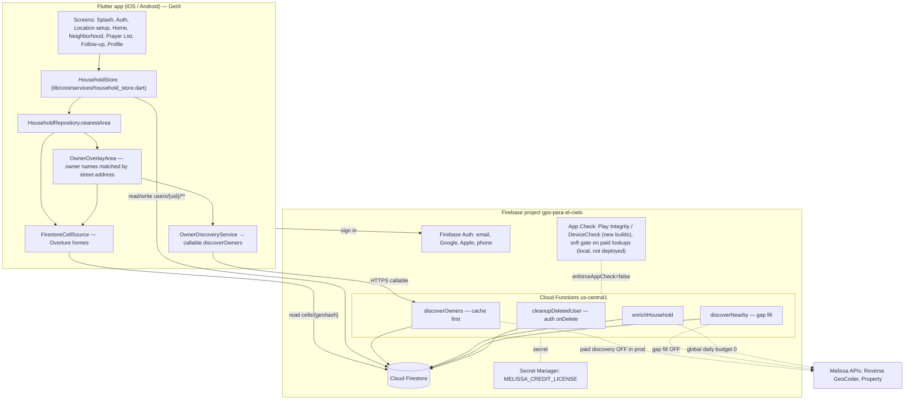

# 1. Complete application architecture

Status legend: solid = live in production (`gps-para-el-cielo`); dashed / "OFF" = built but switched off; "local only" = 2026-11-24 changes not yet deployed.

**What this shows / where in code.** The list of homes comes from Overture building data stored as gzipped geohash cells in Firestore `cells` (`lib/core/data/cell_source.dart`, `HouseholdRepository.nearestArea`). Melissa owner records are an overlay only: `OwnerOverlayArea` (`lib/core/data/owner_discovery.dart`) adds a recorded owner to an Overture home with the same street address. It never adds or replaces homes. All Melissa traffic runs server-side in `functions/src/index.js` (`discoverOwners`, `enrichHousehold`, `discoverNearby`). The Melissa key lives only in Secret Manager. In production every paid path is blocked, because `MELISSA_GLOBAL_DAILY_CREDITS=0` and `MELISSA_OWNER_DISCOVERY_ENABLED=false` (`functions/.env.gps-para-el-cielo`). App Check is not enforced: `ENFORCE_APP_CHECK=false`, and the app ships no App Check provider.
