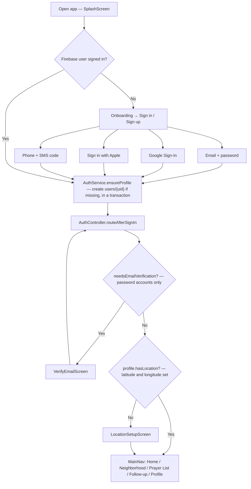
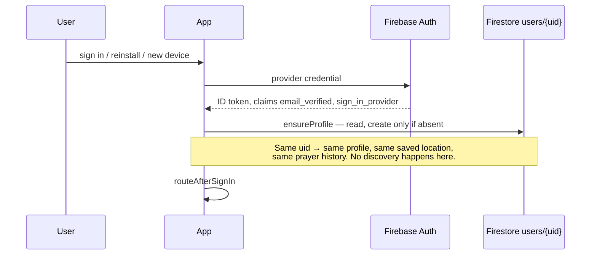

# 2. Signup and authentication flow

**What this shows / where in code.** `lib/features/auth/presentation/controllers/auth_controller.dart` (`loadCurrentProfile`, `routeAfterSignIn`) and `lib/features/auth/domain/services/auth_service.dart` (`ensureProfile`). Signing in, linking a provider, reinstalling or switching devices only reads the existing `users/{uid}`. None of these steps calls Melissa, because discovery runs only when a neighborhood is loaded, and then cache-first. The Firestore rules (`verified()`) block prayer-activity writes from unverified password accounts. The server-side `isVerifiedToken` in `functions/src/owners.js` uses the same claims to gate paid discovery. That gate is local only and not deployed yet.
