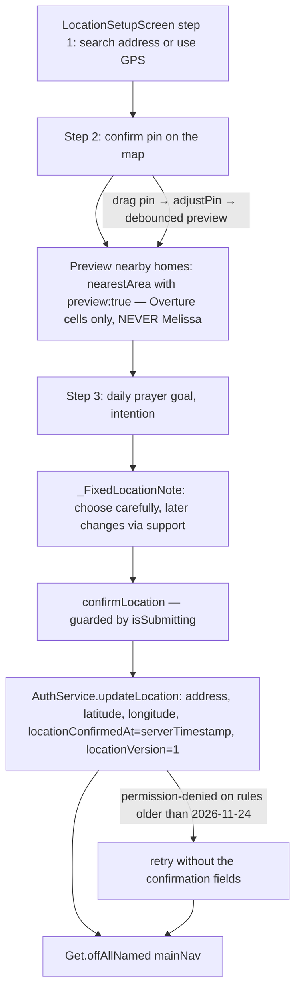
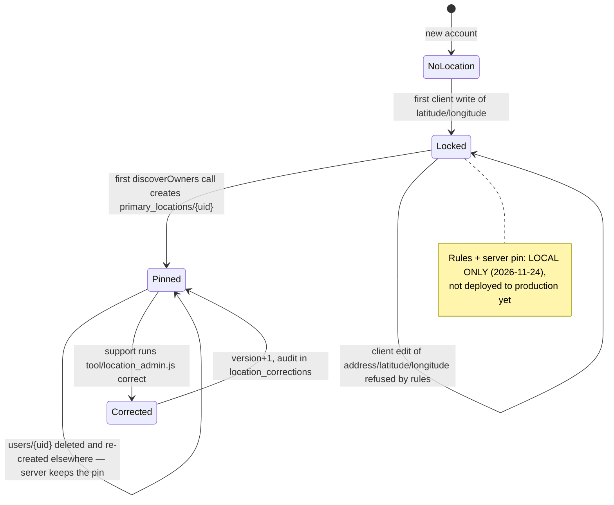

# 3. Primary location onboarding

**What this shows / where in code.** `lib/features/auth/presentation/controllers/location_setup_controller.dart` (`_loadPreview` passes `preview: true`, `confirmLocation`). `HouseholdRepository.nearestArea(preview:)` skips both the gap-fill and the owner overlay, so typing, dragging the pin or map movement can never cost credits. The lock lives in `firestore.rules` (`locationChangeAllowed`, `locationConfirmationValid`). The server pin is `primaryLocation()` in `functions/src/owners.js`. Corrections go through `correctPrimaryLocation()` in `functions/src/location.js`, run only from `functions/tool/location_admin.js`. The app has no edit control: the former Profile address sheet, the "Change home address" buttons and "Set as my home" were all removed.
