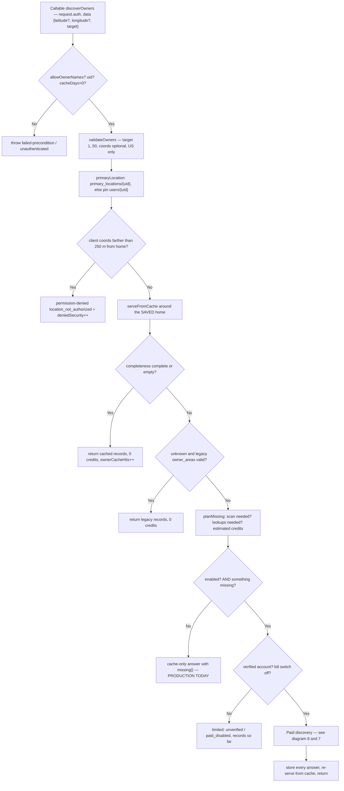

# 4. Cache-first household discovery (`discoverOwners`)

**What this shows / where in code.** `discoverOwners()` in `functions/src/owners.js`, using `serveFromCache()` and `planMissing()` in `functions/src/property_cache.js`. Firestore is always read before Melissa. With `MELISSA_OWNER_DISCOVERY_ENABLED=false` (production and local) the flow stops at "cache-only": it returns what is stored, plus exactly what a paid discovery would add. The location and verified-account checks are part of the 2026-11-24 changes, which are local only and not deployed. The app turns the answer into Overture-matched names through `OwnerArea` and `OwnerOverlayArea` (`lib/core/data/owner_discovery.dart`).
