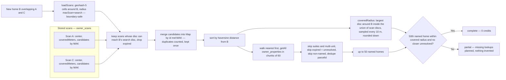
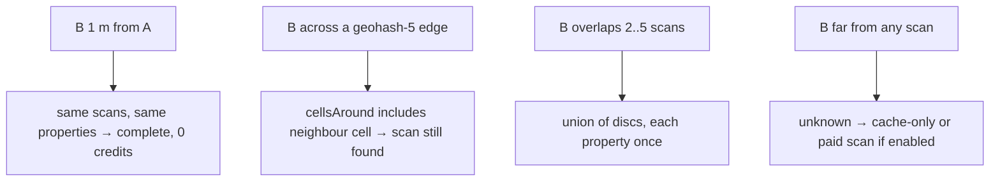

# 5. Overlapping geographic cache reuse

**What this shows / where in code.** `cellsAround`, `loadScans`, `coveredRadius` and `serveFromCache` in `functions/src/property_cache.js`. The tests are in `functions/test/blueprint.test.js`: "A/B 1 m apart", "B overlaps two cached scans", "five cached scans" and "geohash boundary". `owner_properties` are shared by every user (`MELISSA_OWNER_SHARED_CACHE=true`), so a property paid for once is reused by every overlapping neighborhood. Coverage is only labelled `complete` when the union of scan discs proves it. A merely full list of 50 is not enough.
