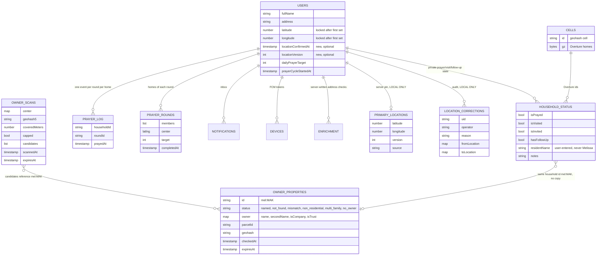

# 6. Firestore data model

| Path | Client access (firestore.rules) | Writer |
|---|---|---|
| `users/{uid}` | owner read/write; location fields locked once set *(local only)* | app |
| `users/{uid}/household_status`, `prayer_log`, `prayer_rounds` | owner only, verified accounts write | app |
| `users/{uid}/enrichment`, `gap_areas` | owner read/delete | functions |
| `cells/{id}`, `households/{id}` | signed-in read | admin seed tools |
| `owner_scans`, `owner_properties`, `owner_areas`, `discovery_jobs`, `melissa_usage/**` | none | functions |
| `primary_locations`, `location_corrections` *(local only)* | none | functions / operator tools |

**What this shows / where in code.** `firestore.rules`, `functions/src/property_cache.js` (`scanDoc`, `propertyDoc`), `functions/src/location.js`, and `lib/core/constants/firestore_paths.dart`. Shared property data and private prayer data are separate layers. Prayer documents reference a household id only and never copy owner data.
