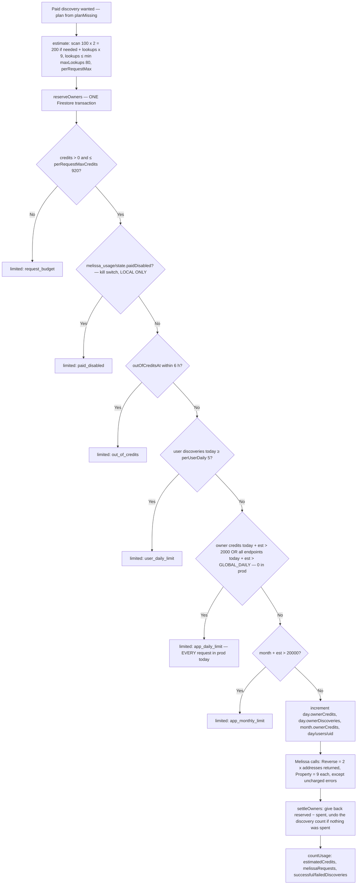

# 7. Melissa credit accounting

| Endpoint | Counter field in `melissa_usage/{day}` | Own limit |
|---|---|---|
| `discoverOwners` | `ownerCredits`, `ownerDiscoveries` (+ `month-YYYY-MM.ownerCredits`) | per request 920, per user 5/day, 2000/day, 20000/month |
| `enrichHousehold` | `credits`, `lookups` | 20 lookups/user/day |
| `discoverNearby` | `gapCredits`, `gapFills` | 3/user/day, 300/day (OFF) |
| all three | `spentToday()` in `budget.js` | `MELISSA_GLOBAL_DAILY_CREDITS` (0 in prod = nothing allowed) |

**What this shows / where in code.** `reserveOwners` and `settleOwners` (`functions/src/owners.js`), `overGlobalLimit`, `spentToday` and `paidDisabled` (`functions/src/budget.js`), and `reserve`/`reserveGap` in `enrich.js`/`discover.js`. All figures are the functions' estimates. Melissa's portal balance is the authority; the last recorded balance is 250 credits, which is less than one new 50-home area costs (~700–920). With a global budget of 0, every paid branch in production ends at `app_daily_limit` before Melissa is contacted.
