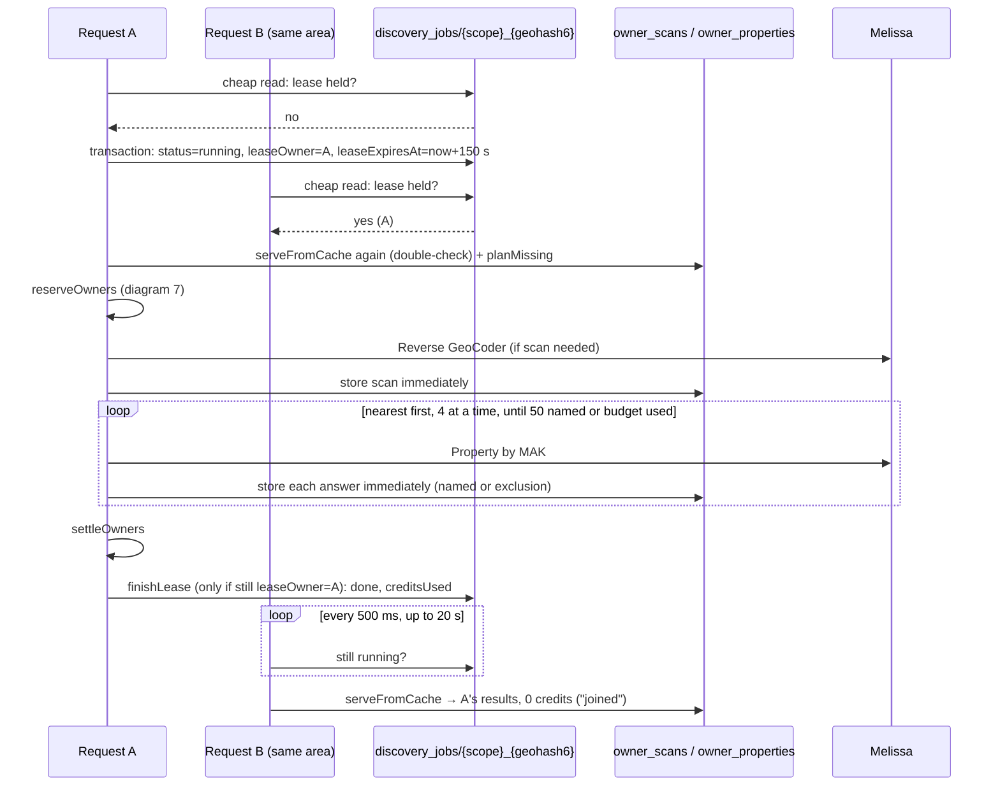
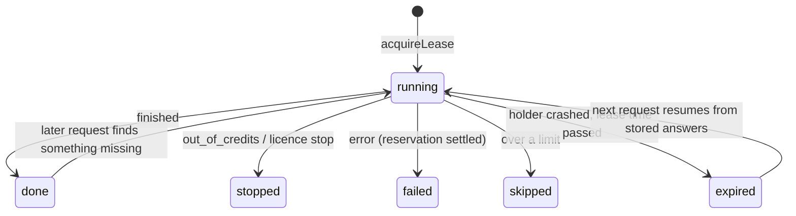

# 8. Concurrent discovery locking

**What this shows / where in code.** `acquireLease`, `lockTransaction`, `waitForLease` and `finishLease` in `functions/src/owners.js`, and `jobIdFor` (scope + geohash-6) in `property_cache.js`. Scans and properties are written as each answer arrives, so a restarted job continues where it left off and never repeats a finished lookup. Tests: "100 simultaneous users, same uncached area: ONE paid discovery" (`owners.test.js`), "retry after partial progress never pays twice" and "expired lease from a restarted function" (`blueprint.test.js`). The lock only matters once paid discovery is enabled, which it is not in production.
