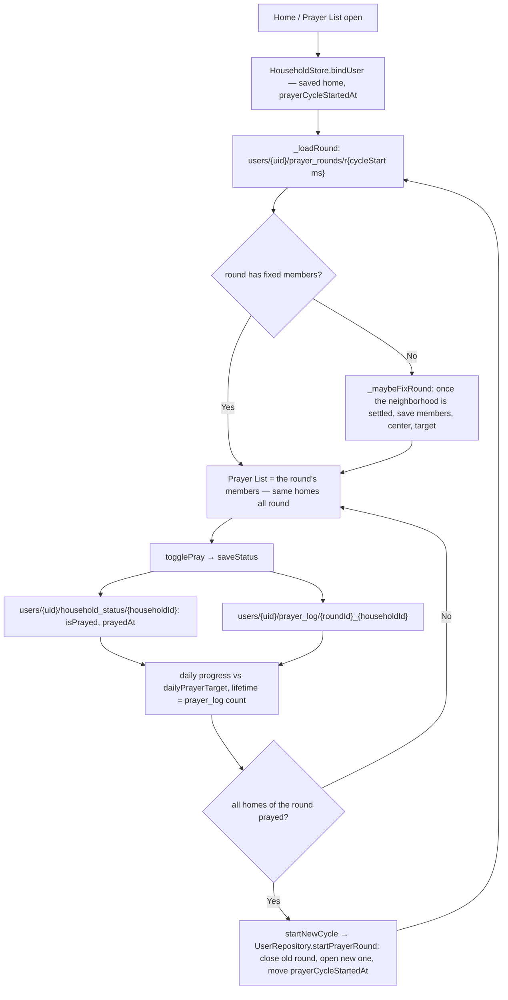
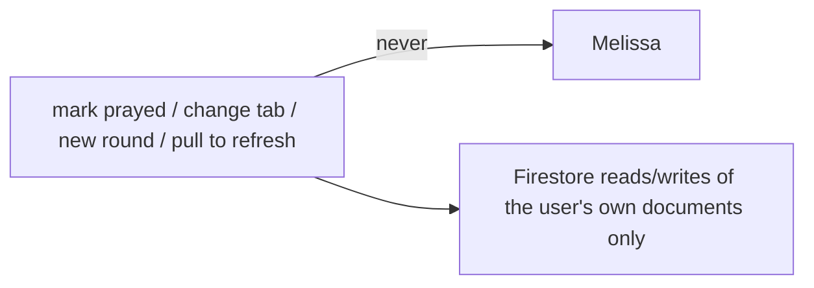

# 9. Prayer List lifecycle

**What this shows / where in code.** `lib/core/services/household_store.dart` (`_loadRound`, `_maybeFixRound`, `_homeList`), `lib/features/prayer_list/domain/services/prayer_list_service.dart` (`togglePray`, `startNewCycle`), `HouseholdRepository.saveStatus`, and `UserRepository.startPrayerRound`. Event ids are `{roundId}_{householdId}`, so earlier rounds are never overwritten. A refresh that would cost money happens only in `discoverOwners`, and it is cache-first and OFF in production.
