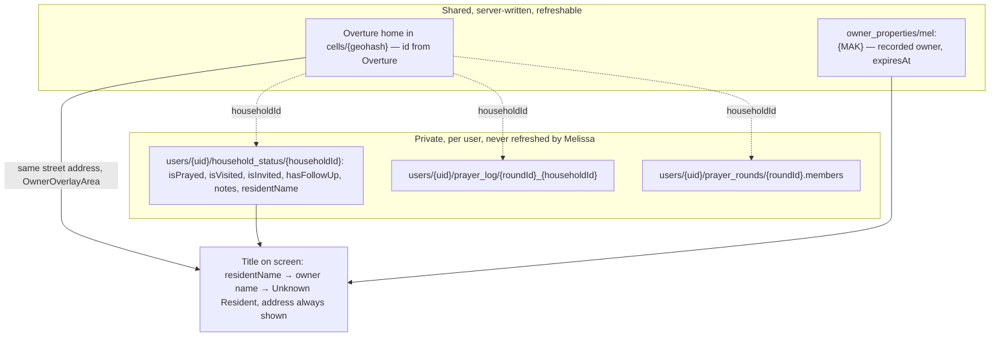
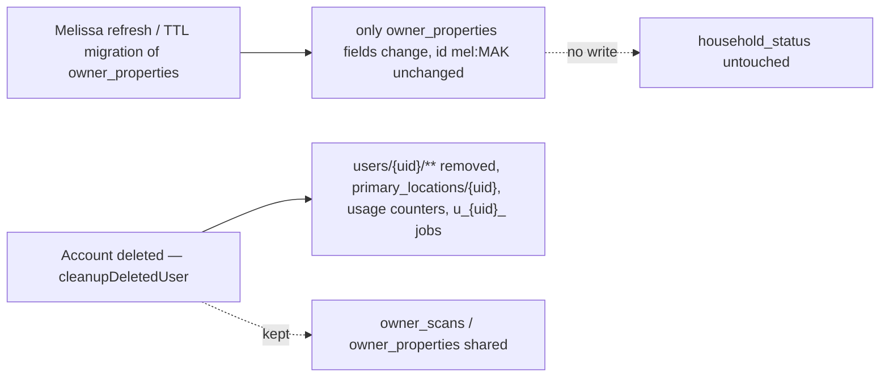

# 10. Household identity and user-specific prayer data

**What this shows / where in code.** Ids are stable keys. Owner records are keyed `mel:{MAK}` (`propertyDoc` in `property_cache.js`), and prayer data is keyed by the household id the app shows. `OwnerOverlayArea` only decorates an Overture home and keeps its id, so prayer history, rounds and follow-ups survive any owner-data change. A user-entered `residentName` is stored separately from the Melissa owner, and an owner is never labelled a verified resident. Deletion runs in `functions/src/cleanup.js` (the per-user job-prefix query was fixed on 2026-11-24; local only).
