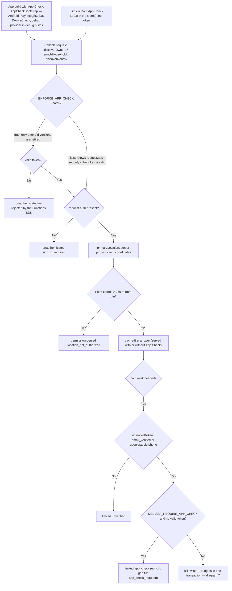
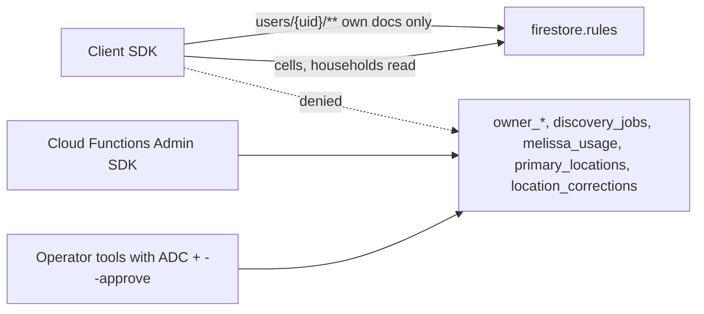

# 11. App Check and backend authorization

**What this shows / where in code.** Client: `lib/core/services/app_check_bootstrap.dart`, activated in `lib/main.dart` right after `Firebase.initializeApp` (activation errors never block startup). Server: `functions/src/index.js` (`appVerified(request)` → `isAppCheckVerified(request.app)` in `functions/src/owners.js`; soft gate `MELISSA_REQUIRE_APP_CHECK=true`; hard gate `enforceAppCheck: ENFORCE_APP_CHECK`, still `false` so builds without App Check keep working on stored data), `functions/src/enrich.js` / `discover.js` (`app_check_required` before any reservation), and `firestore.rules`. Firestore App Check enforcement stays off until old versions are retired. Status: implemented and tested locally (`functions/test/resilience.test.js`), **not deployed**; console steps in [../APP_CHECK.md](../APP_CHECK.md).
