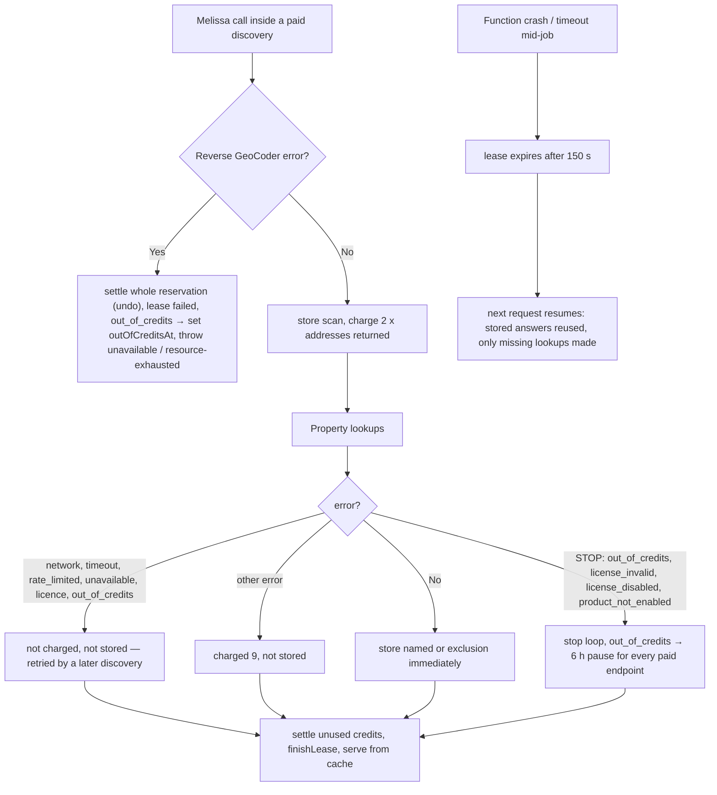
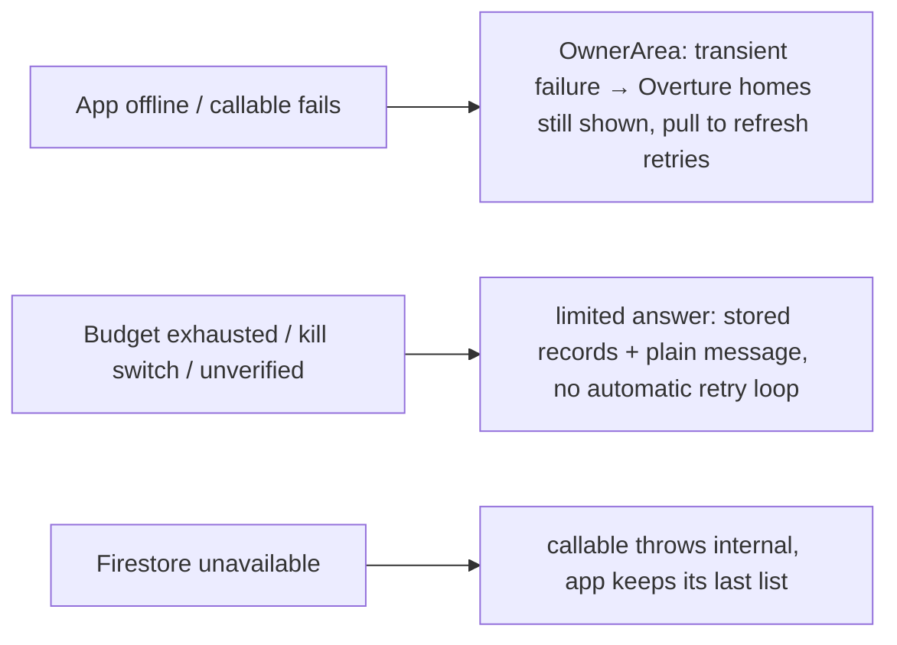

# 12. API failure and recovery

**What this shows / where in code.** The `UNCHARGED` and `STOP` sets and the try/catch in `discoverOwners` (`functions/src/owners.js`), plus `OwnerArea._load` and `OwnerDiscoveryService.isKnownReason` / `messageFor` (`lib/core/data/owner_discovery.dart`). Every stored answer is idempotent by its document id (`mel:{MAK}`, `scanIdFor`), so a retry never pays twice for finished work. Being over a limit now returns a `limited` answer instead of an error (local only, 2026-11-24).
