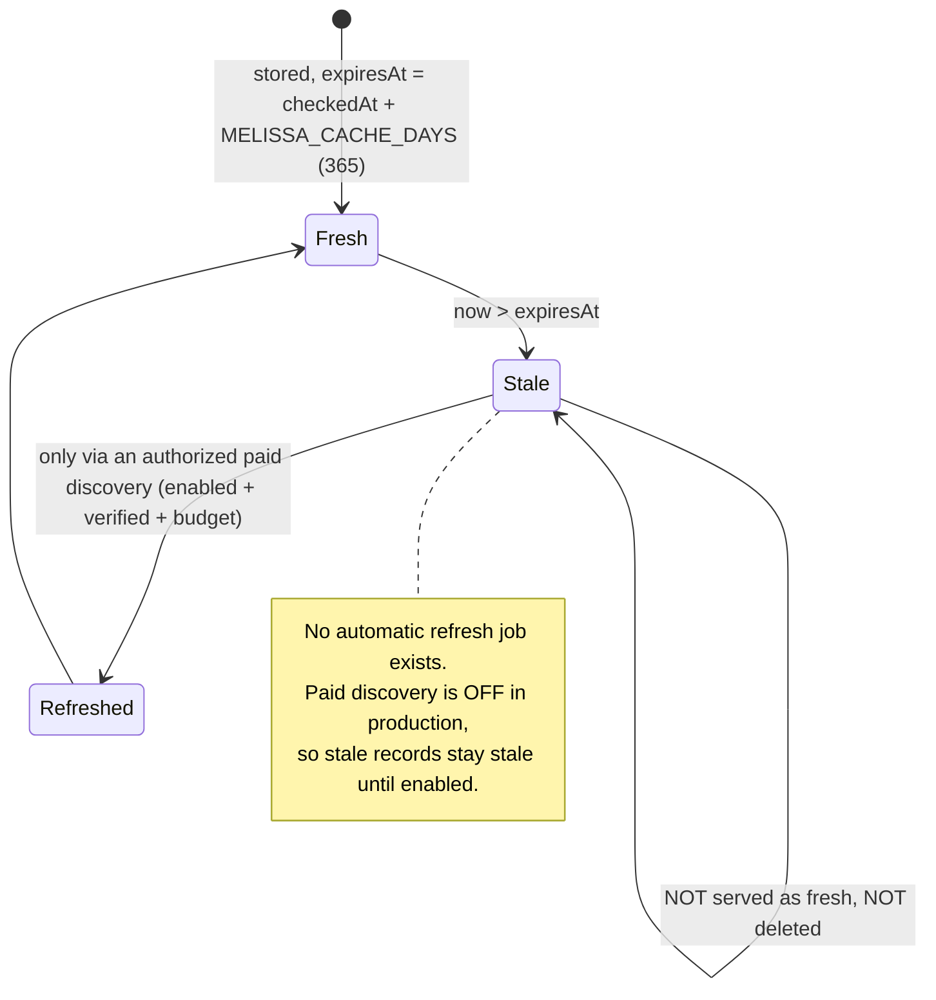
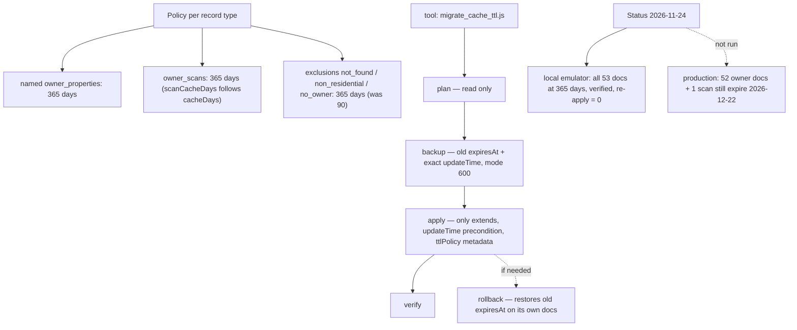

# 13. Data expiration and refresh

**What this shows / where in code.** `valid()` and `serveFromCache` in `functions/src/property_cache.js` hide stale records, which are never deleted. Defaults are `cacheDays: 365` and `negativeCacheDays: 365` in `OWNER_DEFAULTS` (`owners.js`), with `CACHE_DAYS` defaulting to 365 in `index.js`. The migration tool is `functions/tool/migrate_cache_ttl.js`, tested in `functions/test/ops_tools.test.js`. Data-retention cleanup is a separate concern, and no deletion job exists.
