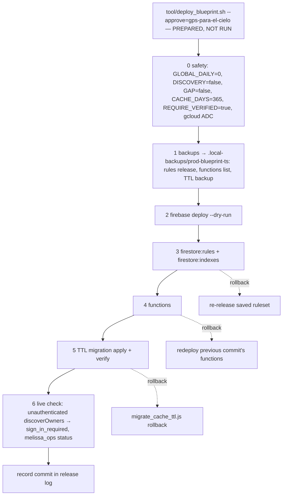
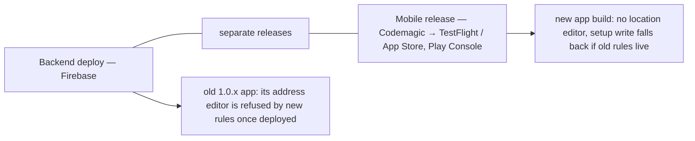

# 14. Production deployment

**What this shows / where in code.** `tool/deploy_blueprint.sh` and `codemagic.yaml`. As of 2026-11-24 nothing from this change is deployed: the project owner chose local only. The live production state is the 2026-11-23 cutover, with rules, 4 functions, owner names from the cache only, and 0 credits.
