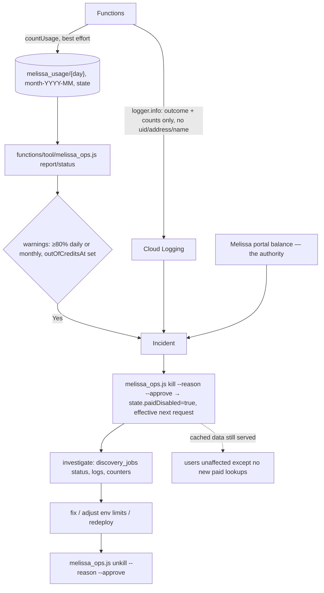

# 15. Monitoring and incident response

| Counter | Meaning |
|---|---|
| `ownerCacheHits` / `ownerCacheMisses` | served free / coverage incomplete |
| `propertiesReused`, `duplicatesAvoided`, `overlapScansUsed` | reuse from the shared cache |
| `successfulDiscoveries`, `failedDiscoveries`, `estimatedCredits`, `melissaRequests` | paid activity |
| `deniedBudget`, `deniedSecurity` | refusals by limit / kill switch, by location / unverified |

**What this shows / where in code.** `countUsage` (`functions/src/owners.js`) and `usageReport`, `warnings` and `setKill` (`functions/tool/melissa_ops.js`). There is no automated alerting (Cloud Monitoring alert policies or a scheduled report), so the report is run by hand. The kill switch and the new counters are local only until deployed.
